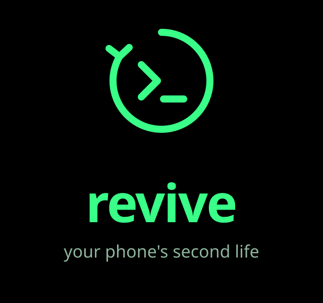
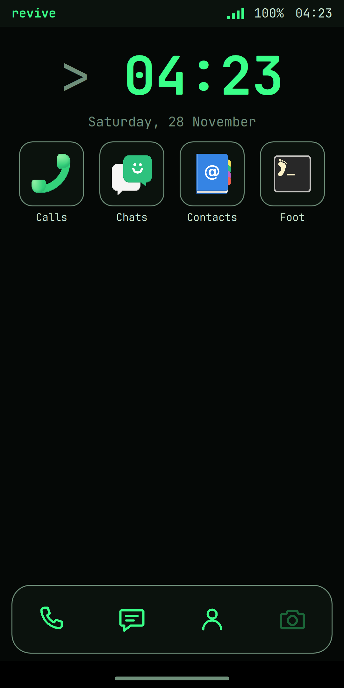
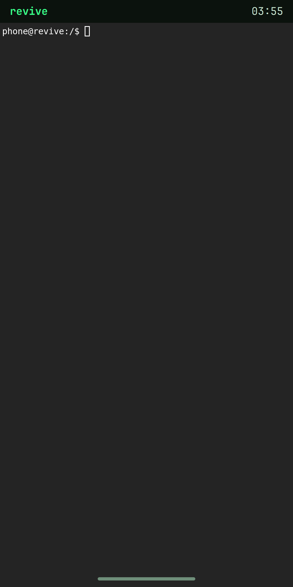
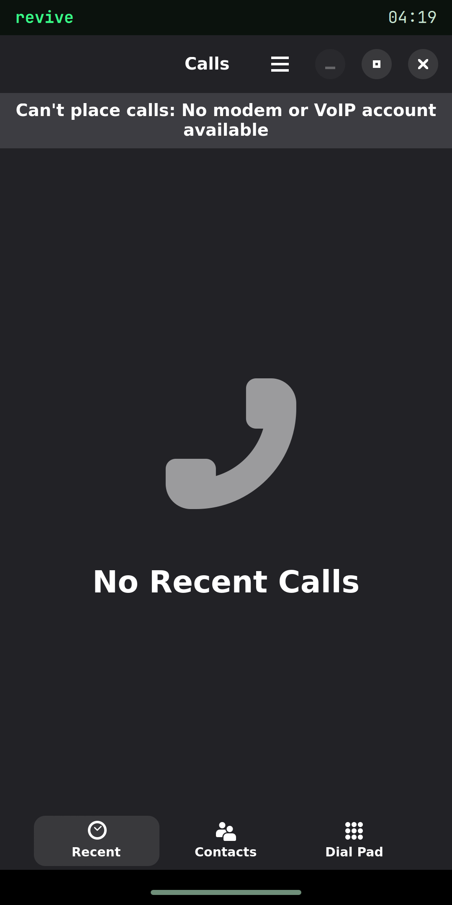

<p align="center"></p>

# revive

*Your phone's second life.* An open-source Linux OS for old Android phones. Android is removed completely: the phone boots a
mainline Linux kernel and a Debian userland, with no Google services, no Halium and no Android
userspace underneath.

**Status: the revive shell runs on the phone.** phoc (wlroots) with revive's own status bar,
launcher and home gesture; Debian apps run on it (terminal, Calls, Chats, Contacts). Calls and SMS
wait on the modem, which still crashes on this phone.

<p align="center">
  
  
  
  
</p>

Screenshots from the Mi A2, in date order, are in [docs/screenshots/](docs/screenshots/).

| Device | Codename | Kernel | Status |
|---|---|---|---|
| Xiaomi Mi A2 | `xiaomi-jasmine` | [sdm660-mainline](https://github.com/sdm660-mainline/linux) 7.2 | stage 1 done: display, touch, on-screen keyboard, USB network + SSH (tested on Windows 11), ~240 MB RAM idle · Wi-Fi (iwd) · shell 3a: launcher + apps |

## Build

Needs Docker (Docker Desktop on Windows/macOS). On a Linux host, enable arm64 emulation once:
`docker run --privileged --rm tonistiigi/binfmt --install arm64`.

```sh
./build.sh xiaomi-jasmine        # → out/xiaomi-jasmine/{boot.img,rootfs.img,vbmeta.img}
```

On Windows, run this from Git Bash or WSL. The first build downloads the kernel and Debian, which takes a while.
Later builds reuse the `linuxphone-work` Docker volume.

## Install (Xiaomi Mi A2)

> **This erases everything on the phone**, and Android is gone until you reflash Xiaomi's stock
> fastboot ROM (`flash_all`).

1. In Android: Settings → About → tap *Build number* 7× → Developer options → enable *OEM unlocking* and *USB debugging*.
2. Unlock the bootloader (confirm on the phone with the volume and power keys):
   ```sh
   adb reboot bootloader
   fastboot flashing unlock
   ```
3. Test the kernel without flashing anything. The kernel log should scroll on the screen, then stop at
   "rootfs not found", which is expected because nothing is flashed yet:
   ```sh
   fastboot boot out/xiaomi-jasmine/boot.img
   ```
4. Flash and boot:
   ```sh
   fastboot reboot bootloader
   fastboot flash --slot=all vbmeta out/xiaomi-jasmine/vbmeta.img
   fastboot flash --slot=all boot   out/xiaomi-jasmine/boot.img
   fastboot flash userdata          out/xiaomi-jasmine/rootfs.img
   fastboot reboot
   ```

## Use

- **On the phone:** log in on the console with the on-screen keyboard.
- **Over USB:** the phone shows up as a USB network adapter and gives your computer an address.
  ```sh
  ssh phone@172.16.42.1
  ```

If SSH doesn't connect, run `usbinfo` on the phone. It shows the USB link state.

The phone boots into revive-shell. Swipe up from the bottom edge to go home. If the shell keeps crashing, tty1 falls back to the text console.

The default login is `phone` / `1234`. **Change it** with `passwd`. Each phone generates its own SSH host
keys on first boot.

## Layout

```
build.sh                 builds kernel, rootfs, initramfs and images for one device
Dockerfile               the build environment
shell/                   revive-shell (Qt Wayland compositor + QML UI); ./shell/dev-deploy.sh builds it on a phone
devices/<codename>/      everything device-specific (see CONTRIBUTING.md)
rootfs/                  files copied into every device's rootfs
```

## License

MIT, see [LICENSE](LICENSE). The Linux kernel and Debian packages keep their own licenses.
